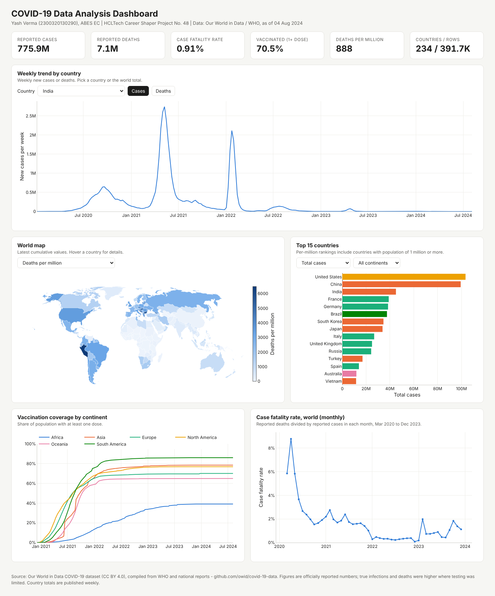

# COVID-19 Data Analysis and Visualisation

**HCLTech Career Shaper Programme | IV Year Industry Project 2026-27 | Project No. 48 | Data Analytics / Python**

| | |
|---|---|
| **Learner** | Yash Verma (Roll No. 2300320130290) |
| **College** | ABES EC |
| **Mentor** | Dipali Kedar Patki |
| **Submission** | 31 October 2026 |
| **Repository** | https://github.com/yashv5461/COVID19-Data-Analysis |

This project explores COVID-19 spread, deaths and vaccination across **234 countries from January 2020 to August 2024**. It uses the public [Our World in Data COVID-19 dataset](https://github.com/owid/covid-19-data), which is compiled from WHO figures. The project cleans 429,435 raw records into a documented 8-column dataset, flags data-quality problems, and presents the findings in 11 charts and an interactive Plotly dashboard.



## Key findings

| Measure (as of 4 Aug 2024) | Value |
|---|---|
| Reported cases | 775.9 million |
| Reported deaths | 7.06 million |
| Case fatality rate | 0.91% overall (2.36% in 2020, down to 0.29% in 2022) |
| Population with at least one vaccine dose | 70.5% (South America 86%, Africa 39%) |
| Highest deaths per million (population ≥ 1M) | Peru (6,490) |
| Rows flagged by quality rules | 5,509 (1.41%) |

1. **Waves.** Deaths peaked in January 2021 (103,719 in one week). Cases peaked with Omicron in January 2022 (23.5M in one week).
2. **Severity fell.** The case fatality rate fell sharply after 2021. Reasons include wider testing, better treatment and vaccination.
3. **Per-capita view.** Totals rank the USA, China and India highest. Per million people, the heaviest reported death rates were in Peru and in Eastern and Central Europe.
4. **Unequal vaccination.** Africa's coverage stayed far behind every other continent.
5. **Reporting artefacts matter.** The single highest week of cases (Dec 2022) was a China reporting backlog of about 40 million cases. The data-quality rules flag it.

## Repository structure

```
COVID19-Data-Analysis/
├── data/
│   ├── dataset.csv              # cleaned dataset: 391,716 rows x 8 columns
│   ├── data_dictionary.csv      # every column described
│   ├── anomalies.csv            # rows flagged by the 5 data-quality rules
│   ├── cleaning_log.csv         # row counts after each cleaning step
│   ├── country_summary.csv      # latest values per country (made by the notebook)
│   ├── country_codes.csv        # ISO codes, used by the dashboard map
│   └── dataset_original.csv     # 500-row file supplied with the brief (audited, not used)
├── notebooks/
│   └── COVID19_Data_Analysis.ipynb   # full EDA with outputs (11 charts)
├── src/
│   ├── prepare_data.py          # downloads + cleans OWID data -> data/dataset.csv
│   ├── build_dashboard.py       # builds dashboard/covid_dashboard.html
│   └── build_notebook.py        # generates the notebook cells
├── dashboard/
│   ├── covid_dashboard.html     # interactive Plotly dashboard (works offline)
│   └── world_countries_110m.geojson
├── images/                      # charts, diagrams, dashboard screenshot
├── docs/
│   ├── Project48_Report_Yash_Verma.docx
│   ├── Project48_Synopsis_Yash_Verma.docx
│   └── Demo_Video_Script.md
├── requirements.txt
└── README.md
```

## How to run

```bash
pip install -r requirements.txt

python src/prepare_data.py        # downloads the OWID file (~98 MB) if missing, writes data/dataset.csv
jupyter notebook notebooks/COVID19_Data_Analysis.ipynb   # run all cells
python src/build_dashboard.py     # writes dashboard/covid_dashboard.html
```

Open `dashboard/covid_dashboard.html` in any web browser. You don't need an internet connection.

You can also use Google Colab. Clone https://github.com/yashv5461/COVID19-Data-Analysis, run `prepare_data.py`, then open the notebook.

## Dataset

The cleaned file `data/dataset.csv` uses the same 8 columns as the dataset in the project brief:

| Column | Description |
|---|---|
| `date` | Reporting date (YYYY-MM-DD). WHO totals update once a week. |
| `country` | Country or territory (234). Regional aggregates are removed. |
| `confirmed` | Cumulative reported cases |
| `deaths` | Cumulative reported deaths |
| `recovered` | **Estimated:** cases confirmed 14 days earlier minus deaths. OWID/WHO don't publish recoveries. |
| `vaccinated` | Cumulative people with at least one dose. The last reported value is carried forward. Empty for 21 territories that never reported. |
| `population` | Population (UN 2022 estimate) |
| `continent` | One of 6 continents |

**Why not the supplied `dataset.csv`?** The 500-row file that came with the brief isn't internally consistent:

- Each country has 5 different populations and continents.
- Vaccinated is greater than population in 68% of rows.
- Cumulative cases rise and fall at random.

The audit is in Section 2 of the notebook. Following the brief's dataset prompt (*"Use Our World in Data COVID-19 dataset ... 200,000+ rows across 200 countries"*), the analysis uses the real data in the same format.

### Data-quality rules

Rows are flagged in `data/anomalies.csv`. None are deleted.

| Rule | Rows |
|---|---|
| vaccinated > population (e.g. UAE, Qatar, Gibraltar vaccinated non-residents) | 4,861 |
| weekly cases > 5× the previous 4-week average (backlogs, sudden waves) | 403 |
| deaths > confirmed (early-2020 mismatches) | 217 |
| cumulative cases decreased (revisions) | 19 |
| cumulative deaths decreased (revisions) | 12 |

## Tech stack

Python 3 · pandas · NumPy · SciPy · Matplotlib · Seaborn · Plotly · Jupyter

## Limitations and ethics

- All figures are **officially reported** numbers. True infections and deaths were higher where testing and death registration were limited.
- `recovered` is an estimate. No conclusion in this project relies on it.
- Correlations between countries don't show cause and effect. For example, the positive link between vaccination and reported deaths reflects confounders such as age structure and reporting quality.
- The data is country-level only. It contains no personal information.
- AI assistance (Claude, by Anthropic) was used for code and drafting. Details are in Appendix C of the report.

## Data source and licence

Data: Our World in Data, *Coronavirus Pandemic (COVID-19)*, compiled from WHO and national sources. Licensed under [CC BY 4.0](https://creativecommons.org/licenses/by/4.0/). Source: https://github.com/owid/covid-19-data.
Map outlines: Natural Earth (public domain), via the world-atlas package.
